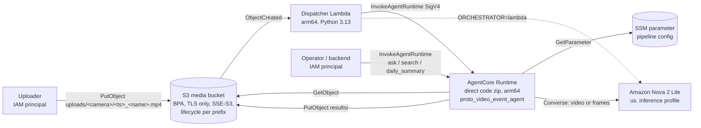
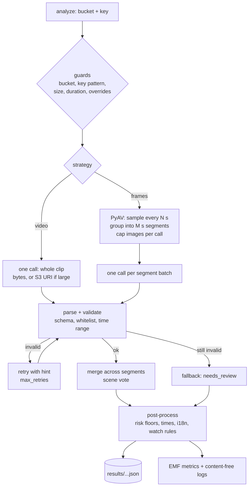

# Architecture

## Components

Inside the runtime (and in local mock mode) every request goes through the same pipeline:

## Code layout

| Path | Role |
|---|---|
| `src/video_events/taxonomy.py` | Closed vocabularies (event types, levels, scenes, locations, subjects) and default risk floors |
| `src/video_events/schema.py`, `validation.py` | Model output contract and hard validation, merging |
| `src/video_events/frames.py` | PyAV probing and frame sampling (in memory) |
| `src/video_events/models.py`, `prompts.py` | Nova Converse adapter, mock model, prompts |
| `src/video_events/pipeline.py` | Strategy planning, calls, retries, fallback, post-processing, metrics |
| `src/video_events/i18n.py`, `rules.py` | Localised templates, structured watch rules |
| `src/video_events/store.py`, `query.py` | Result store (local dir / S3), search, Q&A, daily summary |
| `src/video_events/service.py` | Payload actions and guards shared by AgentCore and Lambda |
| `src/agent/main.py` | AgentCore Runtime entrypoint (`BedrockAgentCoreApp`) |
| `src/functions/dispatcher/handler.py` | S3 event handler: AgentCore or in-process orchestration |
| `infra/` | CDK (Python) stack with cdk-nag AwsSolutions checks |
| `scripts/` | Synthetic set generator, evaluation, strategy comparison, bundle build, e2e and cleanup helpers |

## Result document (per clip)

`schema_version`, `video` (ids, `recorded_at`, duration, key), `model`, `status`
(`ok` / `partial` / `fallback`), `needs_review`, `fallback_reason`, `scene` (type and description),
`events[]` (`event_id`, `category`, `type`, `start_s`, `end_s`, `abs_start`, `abs_end`, `local_time`,
`risk_level`, `model_risk_level`, `confidence`, `location`, `subject`, `description`),
`overall_risk_level`, `summary`, `rejected[]`, `warnings[]`, `localized{locale: overview, headlines}`,
`notifications[]`, and `metrics` (strategy, model calls, retries, validation failures, input and output tokens,
images sent, frames sampled, segments, rejected events, model latency and total time).

## Design trade-offs

- **The orchestration is code, not an autonomous agent** (DECISIONS D2). The runtime is an agent
  host, but during analysis the model has no tools. This gives up some flexibility, for example
  "zoom into segment 3", in exchange for a bounded attack surface when the input is untrusted video.
  Q&A is the only place where the model calls a tool. That tool is read-only and its scope is set
  by code.
- **`video` vs `frames`.** Whole-clip input is one call, and the model samples frames itself (the
  Nova guide describes its sampling). `frames` gives control over density and segment boundaries,
  which matters for short events and long clips. It costs more calls, and splitting a clip into
  segments can break context that spans segments, for example "the parcel was there at the start
  and gone at the end". Measure both with `scripts/compare_strategies.py`.
- **Validation over trust.** Prompt rules are repeated in code. The system never trusts an
  enumerated value, a time or a category that it has not checked.
- **No database.** Results are JSON objects in S3, listed by camera and day. That is enough for a
  prototype and keeps cleanup simple. Larger volumes need an index (handover backlog).

## Limitations

- The synthetic set uses schematic shapes with text labels. It exercises the pipeline, the
  timing logic and the strategy trade-offs, not real-world vision accuracy. The mock model is a
  colour-rule detector that is only meaningful on this set.
- Event times from the model are estimates. With the `video` strategy their resolution depends on
  the model's own sampling.
- No streaming ingest, no end-user authentication, and no rate limiting.
- The Q&A rule parser covers a fixed set of keywords in Chinese, English and Russian.
- Localised text comes from templates. The free-text summary stays in English.

## Fact check (verified 2026-10-20)

| # | Claim used in this repository | Source | Verified |
|---|---|---|---|
| F1 | In us-east-1, `amazon.nova-2-lite-v1:0` accepts TEXT, IMAGE and VIDEO input and is invoked through an inference profile. `us.amazon.nova-2-lite-v1:0` and `global.amazon.nova-2-lite-v1:0` profiles are ACTIVE. `amazon.nova-lite-v1:0` and `amazon.nova-pro-v1:0` also accept video. | `aws bedrock list-foundation-models --by-provider amazon` and `aws bedrock list-inference-profiles` in us-east-1; [Nova 2 code library](https://docs.aws.amazon.com/nova/latest/nova2-userguide/code-library.html) (uses `us.amazon.nova-2-lite-v1:0`) | 2026-10-20 |
| F2 | Nova accepts a video either embedded as bytes (Converse) or as an S3 URI, one video per request. The supported formats include MP4, MOV, MKV and WebM. Size limits differ by input method, so check the guide for the current values. | [Nova 2 multimodal understanding](https://docs.aws.amazon.com/nova/latest/nova2-userguide/using-multimodal-models.html); [Converse VideoSource](https://docs.aws.amazon.com/bedrock/latest/APIReference/API_runtime_VideoSource.html) | 2026-10-20 |
| F3 | Nova samples video frames itself at a rate that depends on clip length. Audio is not analysed. | [Nova 2 multimodal understanding](https://docs.aws.amazon.com/nova/latest/nova2-userguide/using-multimodal-models.html) | 2026-10-20 |
| F4 | Embedded images per request are capped, with a higher cap for S3 URIs. Supported image formats include PNG, JPEG, GIF and WebP. The cap is a config value here (`max_images_per_call`); check the guide for the current number. | same page | 2026-10-20 |
| F5 | Nova models do not identify or name people in images or video. | same page, "Key limitations" | 2026-10-20 |
| F6 | The S3 location in Converse has `uri` and an optional `bucketOwner`. | [Nova 2 code library](https://docs.aws.amazon.com/nova/latest/nova2-userguide/code-library.html); [S3Location](https://docs.aws.amazon.com/bedrock/latest/APIReference/API_runtime_S3Location.html) | 2026-10-20 |
| F7 | AgentCore Runtime supports direct code deployment: a zip with arm64 dependencies uploaded to S3, with `codeConfiguration` (`code.s3.bucket/prefix`, `runtime`, `entryPoint`). The guide installs wheels with `uv pip install --python-platform aarch64-manylinux2014 --only-binary=:all:`. The runtime supports **only arm64**. The package has size limits. | [Direct code deployment for Python](https://docs.aws.amazon.com/bedrock-agentcore/latest/devguide/runtime-get-started-code-deploy-python.html); [Direct code deployment overview](https://docs.aws.amazon.com/bedrock-agentcore/latest/devguide/runtime-get-started-code-deploy.html) | 2026-10-20 |
| F8 | CloudFormation type `AWS::BedrockAgentCore::Runtime` exists in us-east-1. It requires `AgentRuntimeName` (pattern `[a-zA-Z][a-zA-Z0-9_]{0,47}`), `AgentRuntimeArtifact` and `RoleArn`. Runtimes include `PYTHON_3_13`. Network modes are `PUBLIC` and `VPC`. It also has `AuthorizerConfiguration`, `EnvironmentVariables`, `LifecycleConfiguration` and `Tags`. | `aws cloudformation describe-type --type RESOURCE --type-name AWS::BedrockAgentCore::Runtime` (us-east-1) | 2026-10-20 |
| F9 | The execution role trusts `bedrock-agentcore.amazonaws.com`, conditioned on `aws:SourceAccount` and `aws:SourceArn`. It needs CloudWatch Logs on `/aws/bedrock-agentcore/runtimes/*`, X-Ray, `cloudwatch:PutMetricData` (namespace `bedrock-agentcore`), workload access token actions, `bedrock:InvokeModel`, and S3 read of the code package. | [AgentCore Runtime permissions](https://docs.aws.amazon.com/bedrock-agentcore/latest/devguide/runtime-permissions.html); [code deploy guide](https://docs.aws.amazon.com/bedrock-agentcore/latest/devguide/runtime-get-started-code-deploy-python.html) | 2026-10-20 |
| F10 | Each AgentCore Runtime session runs in its own microVM, which is terminated after the session ends. Session ids must be at least 33 characters. Idle sessions stop after a configurable timeout. | [Use isolated sessions](https://docs.aws.amazon.com/bedrock-agentcore/latest/devguide/runtime-sessions.html) | 2026-10-20 |
| F11 | The Lambda `python3.13` runtime runs on Amazon Linux 2023. All supported runtimes support arm64. AWS recommends bundling the SDK in the package instead of relying on the runtime-included version. | [Lambda runtimes](https://docs.aws.amazon.com/lambda/latest/dg/lambda-runtimes.html) | 2026-10-20 |
| F12 | PyAV 19.0.1 on PyPI ships `manylinux_2_28_aarch64` wheels (BSD-3-Clause), so frame sampling needs no Docker build or separate ffmpeg binary. Import inside the deployed Lambda and AgentCore Runtime is checked by the `health` action (see VERIFICATION.md). | [PyPI: av](https://pypi.org/project/av/) | 2026-10-20 |
| F14 | Nova supports `toolChoice` values `tool` (the specified tool is called once, recommended for structured output), `any` and `auto`. It uses constrained decoding against the tool's input schema. (In our runs this still did not guarantee that required fields were present, so the output is validated anyway.) | [Nova 2 using tools](https://docs.aws.amazon.com/nova/latest/nova2-userguide/using-tools.html) | 2026-10-20 |
| F15 | `AWS::BedrockAgentCore::Runtime` `AuthorizerConfiguration` accepts a `CustomJWTAuthorizer`, which is the hardening path for end-user auth. | CloudFormation resource schema (describe-type, us-east-1) | 2026-10-20 |
| F16 | CloudWatch metrics cannot be deleted. They expire automatically when no new data arrives. | [CloudWatch metrics concepts](https://docs.aws.amazon.com/AmazonCloudWatch/latest/monitoring/cloudwatch_concepts.html) | 2026-10-20 |
| F13 | Converse tool use: `toolConfig.tools[].toolSpec` with a JSON `inputSchema`, `stopReason == "tool_use"`, results returned as `toolResult`. | [Nova 2 code library](https://docs.aws.amazon.com/nova/latest/nova2-userguide/code-library.html) ("Tool use") | 2026-10-20 |

Removed because they could not be verified on official pages: none of the claims above. The
repository says nothing about AgentCore Runtime availability in regions other than us-east-1. That
is the region where the CloudFormation type was checked and the deployment ran. Two statements
from the brief were checked by running them, not by reading docs: that PyAV works on arm64 Lambda
and on AgentCore Runtime (the `health` action in VERIFICATION/DEPLOYMENT-LOG), and the glibc
version in both environments.

Pricing and quotas: billing dimensions only. Nova is charged per input and output token, with
video and images counted as input tokens. AgentCore Runtime has its own billing dimensions, as do
Lambda, S3 and CloudWatch. See [Amazon Bedrock pricing](https://aws.amazon.com/bedrock/pricing/) and
[Amazon Bedrock AgentCore pricing](https://aws.amazon.com/bedrock/agentcore/pricing/). No numbers are
given here; check the official pages.
